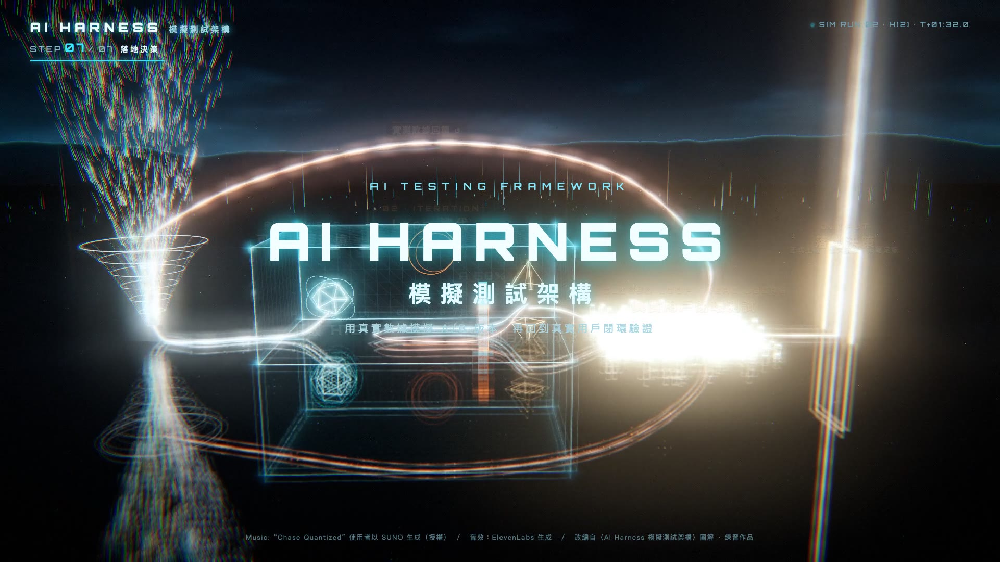

# AI Harness 光流實驗場

把〈AI Harness 模擬測試架構〉流程圖改編成一座霓虹光流 3D 實驗場：真實數據落進模擬結界，假設 H(n) 經過金絲雀測試、A/B 測試、閘門判斷，失敗就進 Loop 迭代修正，達標後走進真實用戶閉環，最後升起落地決策的光柱。

**線上玩：** https://pokemonida99.github.io/ai-harness-lightflow/



## 操作

- 「▶ 開始模擬」：導演鏡頭自動播放 96 秒完整流程（有配樂）
- 拖曳旋轉、滾輪縮放、右鍵平移；拖曳後按「回到導演視角」
- 滑鼠移到節點看說明卡，點節點跳到該段
- 點地面打出光波；雙擊投放一顆數據光點，自己跑完「失敗 → 迭代 → 成功 → 回饋」整圈
- 下方控制列：步驟 1～7、播放／暫停、時間軸、音量；空白鍵播放，←／→ 切換步驟

## 技術

- Three.js r160：鏡面反射地板＋霓虹網格、黑鉻多面體（自製環境貼圖）、沿曲線流動的 GPU 粒子（路徑存成資料貼圖）、雙層光軌、光牆、全息面板 shader
- 後製：UnrealBloom、橫向光芒、色差、顆粒、暗角
- 畫面全部由「故事時間」決定；`timing.js` 把故事時間對到配樂各段落的實際秒數，同一條時間軸可即時互動，也可逐格錄成影片（`tools/record.mjs`）
- 配樂剪輯（`tools/edit_music.py`）在段落起點剪接；節拍包絡（`tools/audio_env.py`）讓畫面跟著低頻脈動；音效依故事時間混進配樂（`tools/mix_sfx.py`），大音效時配樂自動閃避
- 依幀率自動調整渲染解析度

```bash
npm install
npm run build   # src/main.js → app.js
npm run mix     # 重新混音（需要 Python 3 + numpy、ffmpeg；先跑 npm run music 產生 work/music_edit.wav，原曲不在倉庫內）
```

## 授權與來源

- 配樂：“Chase Quantized”，由作者以 SUNO 生成（授權），本倉庫只收剪輯混音後的版本
- 音效：ElevenLabs Sound Effects 生成，非商業練習用途
- 概念圖與分鏡討論：GPT（`art/`）
- 內容改編自〈AI Harness 模擬測試架構〉圖解，練習作品；視覺只借霓虹光線美學，未使用任何電影的角色、載具或標誌設計
